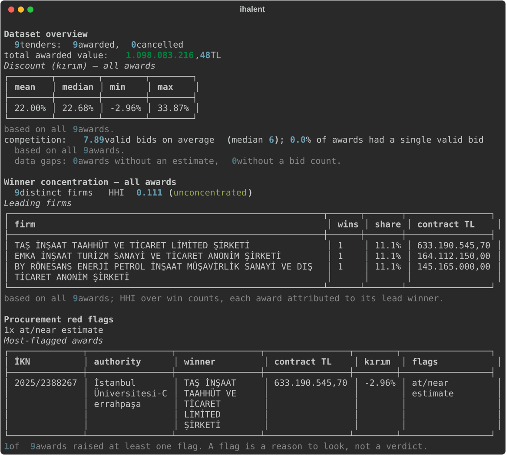

# ihalent

**Turkish public-tender award intelligence: who won, for how much, at what discount, against how many bidders.**

[](https://github.com/gulmezeren2-byte/ihalent/actions/workflows/ci.yml)
[](https://pypi.org/project/ihalent/)
[](pyproject.toml)
[](LICENSE)

> Reads the result notices KİK publishes in the daily **Kamu İhale Bülteni**, and anything you collected earlier with **[saidsurucu/ihale-mcp](https://github.com/saidsurucu/ihale-mcp)**; ihalent structures and analyzes them.

<!-- mcp-name: io.github.gulmezeren2-byte/ihalent -->

Every public tender in Turkey ends with a *Sonuç İlanı* — a result notice that states the
estimate, the contract price, the winner, and how many firms bid. The notices are public.
They are also one at a time, unstructured, and impossible to reason across: you cannot ask
EKAP "what has this company won in the last two years" or "how far below estimate does this
authority actually award." ihalent turns those notices into structured records and answers
exactly those questions — firm histories, discount (kırım) distributions, and competition
metrics — with every number traceable back to the notice it came from.



That is real output over nine real construction awards from the December-2025 / January-2026 window (in
[`examples/`](examples/)). The `-2.96%` at the bottom of the range is not a bug: Istanbul
University awarded a 615-million-lira campus job at **2.96% above** its own estimate,
through an emergency "pazarlık" procedure — a contract signed over the public estimate,
which is precisely the kind of thing that should be easy to see and currently is not.

## Why this exists

I'm an industrial engineer and I work in construction. When our firm weighs a public
tender, the questions that decide the bid are all about other people's history: how far
below estimate does this authority award, how many firms usually show up, what has a given
competitor been winning and at what price. All of that is public — it is sitting in tens of
thousands of result notices on EKAP — and none of it is queryable. So everyone rebuilds a
private, partial version of it by hand, in spreadsheets, badly.

The notices themselves are published in full every working day, in the Kamu İhale Bülteni.
ihalent is the layer that turns that pile of notices into an answer: it reads the bulletin
(or notices you collected earlier with
[saidsurucu/ihale-mcp](https://github.com/saidsurucu/ihale-mcp)), structures them, and does
the analytics that don't exist yet.

## What it answers

**A firm's history** — every award across the dataset, folded across spelling variants:

```
$ ihalent firm examples/sample-awards.jsonl "ÖZDEN YEL"
ÖZDEN YEL
  wins: 1   joint ventures: 1   total contract value: 19.709.997,40 TL
Discount (kırım) — ÖZDEN YEL         
┌────────┬────────┬────────┬────────┐
│ mean   │ median │ min    │ max    │
├────────┼────────┼────────┼────────┤
│ 33.87% │ 33.87% │ 33.87% │ 33.87% │
└────────┴────────┴────────┴────────┘
based on all 1 awards.
  top awarding authorities:
      1x  DSİ 14. Bölge Müdürlüğü
```

**Where the discounts are** — grouped and sorted, highest first:

```
$ ihalent discounts examples/sample-awards.jsonl --by authority
Mean discount by authority                                     
┌──────────────────────────────────┬────────┬────────┬────────┐
│ authority                        │   mean │ median │ awards │
├──────────────────────────────────┼────────┼────────┼────────┤
│ DSİ 14. Bölge Müdürlüğü          │ 33.87% │ 33.87% │    1/1 │
│ Ziraat Bankası Genel Müdürlüğü   │ 31.41% │ 31.41% │    1/1 │
│ İstanbul YİKOB                   │ 26.98% │ 26.98% │    1/1 │
│ İSKİ Genel Müdürlüğü             │ 26.66% │ 26.66% │    1/1 │
│ İTÜ Rektörlüğü                   │ 22.68% │ 22.68% │    1/1 │
│ Esenler Belediyesi               │ 21.99% │ 21.99% │    1/1 │
│ Ağrı İl Özel İdaresi             │ 19.99% │ 19.99% │    1/1 │
│ Kağıthane Belediyesi             │ 17.41% │ 17.41% │    1/1 │
│ İstanbul Üniversitesi-Cerrahpaşa │ -2.96% │ -2.96% │    1/1 │
└──────────────────────────────────┴────────┴────────┴────────┘
awards column: used / considered (excluded lack an estimate, or were awarded in lots).
```

**Competition** — how many valid bids show up, and how often exactly one does (a single-bid
award is a flag procurement watchdogs care about). It's in the overview above.

## The one rule

**A number is never shown without the ground it stands on.** A mean discount always comes
with "over how many awards, and how many were dropped for a missing estimate." A firm's
total contract value says so when some of its wins had no published price, so you read it as
a floor, not the full figure. A discount is `None`, never `0`, when the estimate wasn't
published — ihalent does not invent the numbers the government didn't print. Half the value
of a tool like this is refusing to guess.

## Install

```
pip install ihalent                # the core
pip install "ihalent[bulletin]"    # + reading the Kamu İhale Bülteni PDFs
pip install "ihalent[mcp]"         # + the MCP server
```

Or from source: `pip install git+https://github.com/gulmezeren2-byte/ihalent`.

## The workflow

ihalent reads a JSONL file of awards. The way to produce one is the **Kamu İhale Bülteni**:
KİK prints every result notice in a daily bulletin (Law 4734, Art. 47), one file per
tender type, on EKAP's public bulletin page. ihalent downloads those files and reads them:

```
# 1. collect: today's works (yapım) bulletin, or every working day since a date
#    (earlier days go through the page's archive form)
ihalent fetch-bulletin --out bulletins
ihalent fetch-bulletin --out bulletins --since 2026-11-01

# 2. structure: always over the whole folder (see "Lots" below)
ihalent ingest-bulletin bulletins -o awards.jsonl

# 3. ask:
ihalent overview  awards.jsonl
ihalent firm      awards.jsonl "ACME İNŞAAT"
ihalent discounts awards.jsonl --by authority --min 5
```

`ingest-bulletin` checks every file against the bulletin's own table of contents and
says how many notices it read, rejected, or could not find; it exits 1 if those don't
add up. A notice whose labels and values don't pair up is rejected, never guessed.

**Lots.** A tender awarded in parts (kısmi teklif) gets one notice per lot, and the lots
come out on different days, each printing the tender-wide estimate. ihalent merges them
by İKN and sums the contracts, but gives such a tender **no discount**
(`lots_unverified`): no bulletin says when the last lot has been printed, so comparing
the estimate with the lots seen so far would invent a number. Each lot's winner and
price are kept (`lots`), so a firm is credited only the lots it won.

**What the bulletin does not carry:** a province field. `--by province` stays empty for
bulletin data; ihalent does not infer it. **What was verified:** the works bulletins of
12 and 13 November 2026 — 151 of 151 notices read, each file matching its table of
contents; both were fetched with `fetch-bulletin`, the 12th through the archive form and
the 13th through the day's own button. A notice that says it has no
estimate ("- TRY", or a sentence saying so) is read with the estimate left empty. The
goods, service and consultancy bulletins use the same form but have not been checked yet.

**The older path, via ihale-mcp.** Since September 2026 EKAP's search API asks for human
verification, so collecting with [ihale-mcp](https://github.com/saidsurucu/ihale-mcp)
from your own machine fails with HTTP 428. ihalent does not try to get past that check.
If you still have notices collected that way, `ihalent ingest bundle.json` reads them.

Every command takes `--json` for pipelines and agents. Or skip collection and try the
bundled example directly:

```
git clone https://github.com/gulmezeren2-byte/ihalent && cd ihalent
python examples/build_sample.py       # parses the real notices in examples/notices/
ihalent overview examples/sample-awards.jsonl
```

## Commands

| command | what it does |
|---|---|
| `ihalent overview AWARDS` | value, discount, competition and the data gaps of a dataset |
| `ihalent firm AWARDS "NAME"` | one company's wins, total value, discount, and where it wins |
| `ihalent discounts AWARDS --by X` | mean/median discount grouped by authority, province or tender_type |
| `ihalent single-bid AWARDS` | awards with a single valid bid — no real competition (a watchdog flag) |
| `ihalent concentration AWARDS [--authority X]` | winner concentration (HHI) — do the same few firms win everything? |
| `ihalent flags AWARDS` | per-award red flags: single bid, near-estimate price, no estimate, high drop-off |
| `ihalent fetch-bulletin --out DIR` | download Kamu İhale Bülteni files from EKAP's public bulletin page |
| `ihalent ingest-bulletin DIR` | bulletin result notices → awards JSONL, checked against the table of contents |
| `ihalent parse NOTICE.md` | one result notice → structured JSON |
| `ihalent ingest BUNDLE.json` | collected ihale-mcp/EKAP output → awards JSONL |

## Using it with AI agents

The result notice is unstructured text; the interesting questions are aggregate. That is an
awkward fit for an agent working notice-by-notice, and a natural fit for a tool: `--json`
output with stable fields, an exit code that means something, and a firm-name match that
folds spelling variants so an agent doesn't have to.

There is a native **MCP server** (`pip install 'ihalent[mcp]'`) that exposes the analytics
as tools — `overview`, `firm`, `discounts`, `concentration`, `flags`, `parse_notice`,
`ingest_bundle` — over a dataset you point it at:

```
IHALENT_AWARDS=awards.jsonl ihalent-mcp
```

No local Python? The [`Dockerfile`](Dockerfile) builds the same server:
`docker build -t ihalent . && docker run --rm -i -e IHALENT_AWARDS=/data/awards.jsonl -v "$PWD:/data:ro" ihalent`.

Point it at the awards built from your bulletins and an agent can reason across them in
one session. The Python API (`ihalent.bulletin.read_bulletin`,
`ihalent.bulletin.awards_from_reads`, `ihalent.analytics.firm_profile`) is three calls deep
if you'd rather script it.

## Scope, honestly

- **One narrow network step, and it never forces its way in.** Everything except
  `fetch-bulletin` is a pure function of the files you give it. `fetch-bulletin` asks one
  public page for the files KİK publishes there for anyone: one file per working day and
  tender type, at least two seconds apart, never twice. If that page ever asks for human
  verification or refuses a request, it stops and says so — it does not retry, and
  ihalent will not ship a way around such a check.
- **Company-name folding is conservative on purpose.** It merges legal-form suffixes and
  Turkish spelling variants, and it would rather show two rows for one firm than one row for
  two — so `firm` reports how many distinct spellings a query matched, and warns you if that
  is more than one.
- **The parser tracks one document: the result notice.** Bid-level detail (who else bid, at
  what price) is not in the notice and so is not here. Discount is the estimate-to-contract
  gap, which the notice does carry.
- **Award values are nominal lira, as printed.** Comparing 2023 and 2026 contracts is your
  analysis to make with the dates in hand; ihalent does not silently inflation-adjust.

## What ihalent is not

It is not a scraper of EKAP's search, and not a way around its checks. It is not a live
dashboard or a paid tender-alert service; it is a library and a CLI you point at data you
control. And it does not redistribute a dataset: it ships the
handful of real notices in `examples/` and the code to structure your own.

## A note on the data

Public-tender results are public information, published by the state for public scrutiny.
ihalent structures what EKAP already discloses. Most winners are companies acting in their
public commercial capacity — but some are sole traders, whose name is a private person's
name and personal data under Turkish law (KVKK). So ihalent never keeps the winner's
address, ships no collected bulletins or awards, and leaves publishing what you collect
to you and the law, not to a default.

## How this project is built

I designed the model and the analytics and I review every line; I use AI agents (Claude
Code) heavily for implementation speed, and the commit trailers say so. The contract is the
tests — 119 of them, built on the exact JSON shapes EKAP and ihale-mcp emit and on the
page geometry measured in a real bulletin, including a result notice with a negative
discount, a cancelled tender, a value that runs onto the next page and a tender awarded in
lots. They don't care who typed them.

## Related

- **[acikpoz](https://github.com/gulmezeren2-byte/acikpoz)** — the other half of the Turkish public-procurement picture. `ihalent` reads the tender result notices that say who won and at what discount; `acikpoz` reads the unit-price (birim fiyat) catalogs that say what the work *should* have cost. Same discipline: every figure traceable to its source, nothing invented.

More tools by [Eren Gülmez](https://github.com/gulmezeren2-byte?tab=repositories).

## License

[MIT](LICENSE) — Mehmet Eren Gülmez
